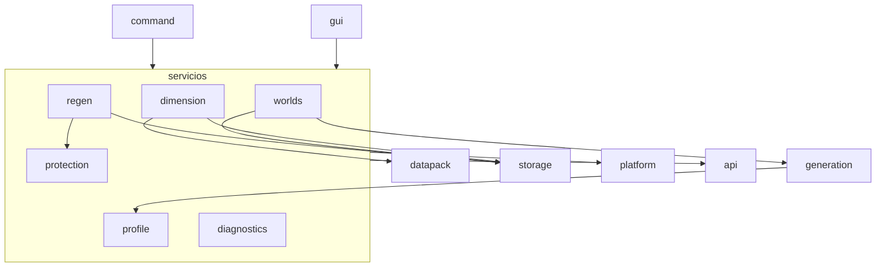
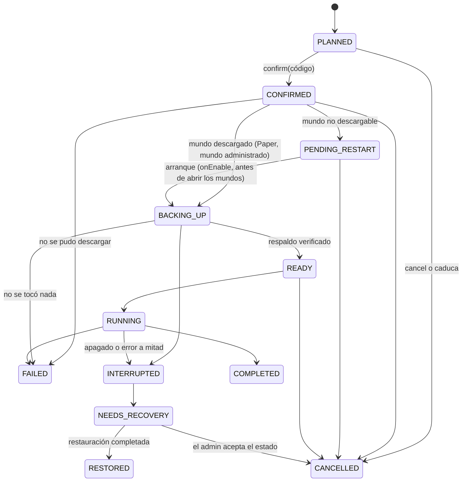

# WorldForge — Arquitectura

Un solo proyecto Gradle (`worldforge/`), un solo jar (`RPGRoll-WorldForge`). Se compila
**aparte** del resto de RPGRoll (D15): `worldforge/settings.gradle.kts` reutiliza `build-logic`
y `:licensing` del repo, pero el `settings.gradle.kts` de la raíz no lo incluye.
Los «módulos lógicos» del encargo son **paquetes** con fronteras claras: catorce
subproyectos Gradle encarecerían la compilación sin aportar nada a un jar único.

Raíz de paquetes: `com.sack.rpgroll.worldforge`.

| Paquete | Módulo lógico | Responsabilidad |
|---|---|---|
| `api` | worldforge-api | Identificadores validados, `Result`, capacidades, contrato `GenerationProvider` |
| `core` | worldforge-core | `WorldForgePlugin`: arranque, cableado explícito de servicios, apagado |
| `platform` | worldforge-folia | `Platform`: ejecutar en la región de un chunk, en lo global o fuera del tick; detecta Folia |
| `profile` | worldforge-presets | Modelo de perfil, codec YAML versionado, validación, presets de serie |
| `generation` | worldforge-generation | Proveedores (`vanilla`, `empty`, `hybrid`, `flat`, `terrain`, `plugin`), el `ChunkGenerator` de WorldForge y su motor de terreno (`TerrainEngine`) |
| `terrain` | worldforge-generation | Terrenos de `terrains/*.yml` (`TerrainSpec`) y su traducción a datapack (`TerrainWriter`) |
| `gravity` | worldforge-worlds | Gravedad de los jugadores por mundo (modificador de atributo transitorio) |
| `worlds` | worldforge-worlds | Crear, cargar, descargar, inspeccionar y restaurar al arrancar los mundos administrados |
| `dimension` | worldforge-dimensions | Datapack `worldforge` y ciclo de vida de sus dimensiones: PENDING_RESTART → READY / ERROR, PENDING_REMOVAL → REMOVED |
| `template` | worldforge-structures | Plantillas `.nbt` en `structures/`: guardar desde el mundo, leer, comprobar |
| `regen` | worldforge-regeneration | Plan, simulación, respaldo, ejecución sobre archivos de región, recuperación |
| `protection` | worldforge-protection | Regiones protegidas y exclusiones |
| `storage` | worldforge-storage | SQLite (executor propio, migraciones), YAML atómico |
| `gui` | worldforge-gui | Menús con sesión y control de versión |
| `command` | worldforge-commands | `/worldforge`, autocompletado y permisos |
| `diagnostics` | worldforge-diagnostics | Informe de estado |

Comandos y GUI **no contienen lógica**: los dos llaman a los mismos servicios
(`WorldService`, `ProfileService`, `RegenService`…), que devuelven `Result`.

## Dependencias entre paquetes



Ningún paquete de servicio importa `gui` ni `command`. `platform` es el único
que conoce los schedulers.

## Hilos (Paper y Folia)

| Trabajo | Dónde corre | Por qué |
|---|---|---|
| SQLite | un executor propio de **un** hilo (`storage`) | sin consultas en el tick; una conexión, nunca compartida entre hilos |
| Leer y escribir YAML, copiar respaldos, hash, editar `.mca` | `AsyncScheduler` | disco fuera del tick |
| Crear, cargar o descargar mundos | `GlobalRegionScheduler` (en Paper es el hilo principal) | en Folia no existe: se bloquea con mensaje |
| Leer o escribir bloques | `RegionScheduler.execute(world, cx, cz, …)` | dueño del chunk, en Paper y en Folia |
| Abrir menús, mandar mensajes a un jugador | `EntityScheduler` del jugador | dueño de la entidad |
| Generación de chunks | la llama el servidor | `BlockPopulator` solo toca su `LimitedRegion` |

## Proveedores de generación

```java
interface GenerationProvider {
    String id();                          // "vanilla", "empty", "flat", "hybrid"
    String description();
    Set<Capability> capabilities();       // lo que de verdad controla
    ChunkGenerator generator(Profile p);  // null = el de Minecraft
    WorldCreator configure(WorldCreator c, Profile p);
}
```

Cada `Capability` (SEED, ENVIRONMENT, WORLD_TYPE, STRUCTURES, SPAWN, PLATFORM,
LAYERS, BIOMES, ORES, TEMPLATES) es una promesa probada en Paper 26.1.2.
`ProfileValidator` compara lo que pide el perfil con lo que declara su proveedor
y devuelve como **error** cada campo que el proveedor no controla: nunca se
ignora en silencio.

| Proveedor | Terreno | Menas | Plantillas | Estructuras vanilla |
|---|---|---|---|---|
| `vanilla` | Minecraft (normal, amplificado, biomas grandes) | — | — | sí / no |
| `empty` | nada (plataforma opcional) | — | sí | — |
| `flat` | capas del perfil | sí | sí | — |
| `hybrid` | Minecraft | sí | sí | sí / no |
| `terrain` | `TerrainEngine` (ruido simplex de Bukkit) + superficie, cuevas y decoración de Minecraft | sí | sí | sí / no |
| `plugin` | el `ChunkGenerator` de otro plugin (`WorldCreator.getGeneratorForName`) | — | — | lo que haga ese plugin |

Menas y plantillas son `BlockPopulator`: solo actúan en chunks que Minecraft
genera a partir de ese momento y solo escriben en su `LimitedRegion`.

## Terrenos

Un `TerrainSpec` (altura, desplazamiento, picos, tamaños de continentes, erosión,
crestas y clima, nivel del mar, acuíferos, vetas) llega al mundo por dos caminos:

- **Datapack** (dimensiones `terrain:<id>` y `terrain main`). `TerrainWriter` lee
  el JSON de vanilla del jar del servidor (`data/minecraft/worldgen/...`, no el
  registro: así ningún otro datapack se cuela), copia cada función de densidad
  `minecraft:overworld…/…` que alcanza el *noise router* a `worldforge:<id>/…`
  con las referencias reescritas, y cambia solo números:
  `offset' = k·(offset + 0,5) − 0,5 + h/128` (la superficie de vanilla está en
  y = 128 + 128·offset, así que el relieve se estira `k` veces alrededor de
  y=64), `factor' = factor/k`, `jaggedness' = k·picos·jaggedness`, y el
  `xz_scale` del ruido de continentes, erosión, crestas, temperatura y humedad
  dividido por su tamaño. El gradiente de profundidad se prolonga (misma recta)
  hasta y=2032 para que las funciones no dependan del tipo de dimensión; el
  techo del router (`top_slide` y el límite de `preliminary_surface_level`) va
  en el `noise_settings` de cada tipo. Con todo a 1 sale lo mismo que vanilla.
- **Motor propio** (`provider: terrain`), para mundos creados en caliente, donde
  Minecraft no deja usar un `noise_settings` de datapack. Altura por columna con
  `SimplexOctaveGenerator`; Minecraft pone superficie, cuevas, decoración y
  estructuras encima (`getBaseHeight` les da el suelo); biomas por altura y clima.

## Modelo de dominio

- `Profile`: id, nombre, descripción, `schemaVersion`, `targetMinecraft`,
  proveedor, semilla opcional, entorno, estructuras vanilla, spawn, plataforma,
  biomas, reglas de menas, plantillas.
- `OreRule`: id, bloque, `replaces`, venas por chunk, tamaño, y mín/máx,
  distribución (`uniform`, `triangle`), biomas permitidos/excluidos, prioridad, activa.
- `TemplateRule`: id, plantilla (`structures/<nombre>.nbt`), rareza (1 de cada N
  chunks), colocación (`surface` sobre el primer bloque sólido, nunca sobre agua;
  `underground` con la base entre min-y y max-y), desplazamiento en y, giro
  (`random`, `none`), biomas permitidos/excluidos, activa.
- `ManagedWorld`: nombre, perfil, versión del perfil, estado.
- `Dimension`: id, tipo de dimensión (overworld, caves, tall, nether, end),
  generador (void, flat, overworld, amplified, nether, end), estado
  (`PENDING_RESTART`, `READY`, `ERROR`, `PENDING_REMOVAL`, `REMOVED`).
- `Job`: id, tipo (`regen`, `restore`), mundo, plan de chunks, estado, código de
  confirmación, progreso, respaldo.
- `ProtectedRegion`: nombre, mundo, caja en bloques o chunks, motivo.

## Estados de un trabajo



Las transiciones válidas viven en `JobState.next()` con pruebas. La base de datos
hace cada cambio con `UPDATE … WHERE id = ? AND state = ?`: un doble clic o dos
comandos a la vez no pueden confirmar ni lanzar dos veces el mismo trabajo
(probado: `BackupsAndJobsTest` y el escenario de la fase 7).

**Corrección respecto al diseño de la fase 1:** el respaldo se hacía al
confirmar, con el servidor todavía usando los archivos (copia posiblemente
incoherente) y, en el mundo principal, horas antes de editar (se perdería lo
hecho entre medias). Ahora se respalda justo antes de editar: tras descargar el
mundo, o al arrancar antes de abrir los mundos.

## Flujo de regeneración

1. **Plan** (`/wf regen plan <mundo> radius|area|all`): el mundo debe estar
   cargado (se leen su carpeta y su aparición y se guarda con `World.save()`).
   Se leen las cabeceras de las regiones; se quitan los chunks protegidos (zonas
   de `protections.yml` + cuadrado alrededor de la aparición) y los nunca
   generados. Se guarda el plan (lista de chunks) con un código de 6 cifras.
2. **Vista previa**: chunks a regenerar, protegidos, sin generar, bytes del
   respaldo, si será ahora o al reiniciar, y la advertencia de pérdida.
3. **Confirmar con el código** antes de que caduque
   (`regeneration.confirm-minutes`). Se comprueba que no haya otro trabajo que
   bloquee el mundo y que quepa el respaldo.
4. **Ejecución**:
   - mundo administrado en Paper: los jugadores van a la aparición principal
     (se espera a que terminen los teletransportes), se descarga, respaldo,
     edición, se vuelve a cargar;
   - mundo principal, sus dimensiones, dimensiones de datapack o Folia:
     `PENDING_RESTART`; en el siguiente arranque, en `onEnable` (STARTUP, antes
     de «Preparing level»), respaldo y edición.
5. **Respaldo**: copia de los `.mca` afectados (region, entities, poi) y sus
   `.mcc`, manifiesto `sha256 tamaño ruta`; cada copia se relee y se comprueba.
6. Al editar se vuelven a consultar las zonas protegidas: una zona añadida
   después del plan también se respeta.
7. Si el servidor se apaga a mitad de la edición, al arrancar el trabajo pasa a
   `NEEDS_RECOVERY` (nunca se reanuda solo) y el mundo queda bloqueado hasta
   `/wf regen restore` (otro trabajo, con su propio plan, código y respaldo
   previo) o `/wf regen accept`.

Editar un `.mca` = poner a cero la entrada del chunk en la tabla de posiciones
y de fechas, y borrar su `.mcc` si existía. El servidor lo regenera la próxima
vez que lo carga (probado, FEASIBILITY P8 y P9). Restaurar devuelve **archivos
de región enteros** (32×32 chunks) al momento del respaldo; la vista previa lo
advierte.

## Persistencia

**YAML** (lo que edita el admin, exportable): `config.yml`, `messages.yml`,
`presets/<id>.yml`, `protections.yml`. Escritura atómica: archivo temporal en la
misma carpeta + `ATOMIC_MOVE`. Antes de migrar un esquema se guarda `.bak`.
Un YAML con errores **no** se reescribe con valores por defecto: se conserva y
se informa.

**SQLite** (`worldforge.db`, estado operativo):

```sql
schema_version(version INTEGER NOT NULL)
managed_worlds(name TEXT PRIMARY KEY, profile_id TEXT NOT NULL, profile_hash TEXT NOT NULL,
               status TEXT NOT NULL, created_at INTEGER NOT NULL, created_by TEXT NOT NULL)
profile_versions(profile_id TEXT NOT NULL, hash TEXT NOT NULL, saved_at INTEGER NOT NULL,
                 saved_by TEXT NOT NULL, PRIMARY KEY(profile_id, hash))
dimensions(id TEXT PRIMARY KEY, profile_id TEXT NOT NULL, state TEXT NOT NULL,
           message TEXT, updated_at INTEGER NOT NULL)
jobs(id TEXT PRIMARY KEY, type TEXT NOT NULL, world TEXT NOT NULL, dimension_dir TEXT NOT NULL,
     state TEXT NOT NULL, token TEXT NOT NULL, plan TEXT NOT NULL, total INTEGER NOT NULL,
     done INTEGER NOT NULL, failed INTEGER NOT NULL, backup_id TEXT, message TEXT,
     created_by TEXT NOT NULL, created_at INTEGER NOT NULL, updated_at INTEGER NOT NULL)
backups(id TEXT PRIMARY KEY, job_id TEXT, world TEXT NOT NULL, path TEXT NOT NULL,
        files INTEGER NOT NULL, bytes INTEGER NOT NULL, manifest_sha256 TEXT NOT NULL,
        verified INTEGER NOT NULL, created_at INTEGER NOT NULL)
history(id INTEGER PRIMARY KEY AUTOINCREMENT, ts INTEGER NOT NULL, actor TEXT NOT NULL,
        action TEXT NOT NULL, target TEXT, detail TEXT)
```

Índices: `jobs(state)`, `jobs(world)`, `history(ts)`. Migraciones numeradas en
`storage/Migrations`, cada una en su transacción.

**Reconciliación al arrancar**: mundos de `managed_worlds` que no existen en
disco → `MISSING`; trabajos en `RUNNING` o `BACKING_UP` → `INTERRUPTED`;
dimensiones `PENDING_RESTART` cuyo mundo ya cargó → `READY`.

## Registro de decisiones

| # | Decisión | Motivo |
|---|---|---|
| D1 | Un subproyecto con paquetes, no 14 subproyectos | jar único; fronteras por paquete |
| D2 | Sin RPGRoll-Lib | la librería no carga en Folia (FEASIBILITY §1) |
| D3 | Paper API 26.1.2 estable | última de la rama 26.1; el resto del repo sigue en la alpha |
| D4 | Regenerar editando el encabezado `.mca` | `regenerateChunk` lanza; sin NMS; probado |
| D5 | Dimensiones nuevas solo por datapack + reinicio | Bukkit no registra dimensiones en caliente; probado |
| D6 | SQLite del servidor, no embebido | Paper y Folia lo traen; ahorra ~13 MB de nativos |
| D7 | Schedulers de Paper también en Paper | `RegionScheduler` y compañía existen en Paper: un solo código |
| D8 | Comandos clásicos (`plugin.yml` + `TabCompleter`) | funcionan igual en Paper y Folia |
| D9 | No se ofrecen menas en chunks ya generados | sería recorrer el mundo reemplazando bloques |
| D10 | Fuera del release del ecosistema hasta pasar la aceptación | no distribuir lo no verificado |
| D11 | Respaldo justo antes de editar, no al confirmar | copia coherente y sin perder lo hecho hasta el reinicio |
| D12 | Restaurar es otro trabajo (plan, código, respaldo previo) | mismo camino seguro; una restauración también se puede deshacer |
| D13 | Un `protections.yml` ilegible bloquea la regeneración | «no se pudo leer» no puede significar «nada protegido» |
| D14 | La plataforma de aparición la coloca el generador | así existe también en mundos de `bukkit.yml` |
| D15 | WorldForge se compila aparte (`worldforge/settings.gradle.kts`) | estando en el `settings` de la raíz se coló en una release del ecosistema; `:licensing` compila a `worldforge/build/licensing` para que un jar de desarrollo no deje nada en `licensing/build` |
| D16 | Plantillas en el formato `.nbt` de Minecraft, colocadas con `Structure.place(LimitedRegion…)` | API pública; sirve un archivo hecho con un bloque de estructura; sin NMS |
| D17 | Una plantilla guardada no se sobrescribe, y crear/cargar un mundo vuelve a validar sus plantillas | un preset publicado está versionado por su texto, pero la plantilla vive en otro archivo |
| D18 | Plantillas de 32×64×32 como mucho | el populator solo puede escribir un chunk alrededor del suyo (`getBuffer()`), menos un bloque que Minecraft actualiza en el borde |
| D19 | Terrenos por datapack transformando el router de vanilla, no escribiendo uno nuevo | se conservan cuevas, acuíferos, biomas y estructuras de Minecraft; con todo a 1 sale lo mismo que el generador normal (misma piedra por franjas en las columnas medidas, escenario-terreno) |
| D20 | El JSON de partida sale del jar del servidor | un datapack como Terralith que reemplaza `minecraft:overworld/*` no cambia los terrenos de WorldForge |
| D21 | Un terreno escrito en el datapack no se reescribe con otros valores | una dimensión que ya lo usa cambiaría en sus chunks nuevos |
| D22 | Motor propio para mundos en caliente, con los mismos ajustes | Bukkit no deja elegir `noise_settings` al crear un mundo; el motor no es idéntico a vanilla y lo dice |
| D23 | Gravedad solo de jugadores, con un modificador transitorio | `Attribute.GRAVITY` existe en 26.1; transitorio para que no quede en el jugador si se quita el plugin |
